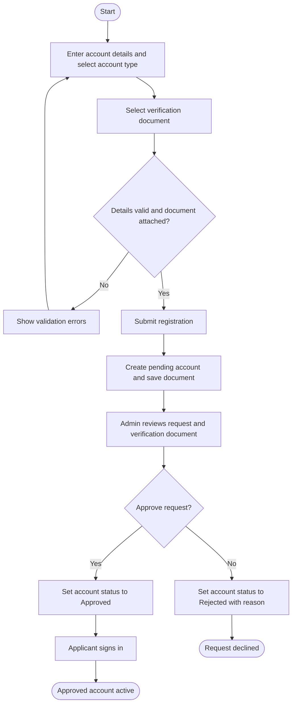

# Activity Diagrams — Major Processes

The diagrams below describe the main user and system workflows in the Barangay Bangbang Portal.

## 1. Account Registration and Approval



## 2. Resident Complaint Submission

```mermaid
flowchart TD
  start([Start])
  compose[Enter complaint details]
  evidence[Optionally attach evidence photo]
  validate{Required complaint details valid?}
  fix[Show errors and update complaint]
  auth{Approved account signed in?}
  limit{Daily report quota available?}
  quotaError[Show daily limit and reset time]
  exact{Same active complaint already filed by resident?}
  exactError[Show existing report status]
  summarize[Generate English summary and embedding]
  match[Search for active complaint in same category and location]
  duplicate{Similar complaint found?}
  claimed{Resident already claimed this duplicate group?}
  claimError[Release reserved quota and show already reported message]
  saveDuplicate[Save report, reporter identity, and group claim]
  count[Count distinct reporters in group]
  saveNew[Save report as a new group and record reporter identity]
  resultDup([Show duplicate result and reporter count])
  resultNew([Show successful new complaint submission])
  failure[On submission failure, release reserved quota]
  end([End])

  start --> compose --> evidence --> validate
  validate -- No --> fix --> compose
  validate -- Yes --> auth
  auth -- No --> failure
  auth -- Yes --> limit
  limit -- No --> quotaError --> end
  limit -- Yes --> exact
  exact -- Yes --> exactError --> end
  exact -- No --> summarize --> match --> duplicate
  duplicate -- Yes --> claimed
  claimed -- Yes --> claimError --> end
  claimed -- No --> saveDuplicate --> count --> resultDup --> end
  duplicate -- No --> saveNew --> resultNew --> end
  failure --> end
```

## 3. Summon Submission and Case Processing

```mermaid
flowchart TD
  start([Start])
  enter[Enter case details, reason, and respondent information]
  validate{Case details and at least one respondent valid?}
  fix[Show validation errors]
  auth{Approved account signed in?}
  limit{Resident quota available or submitter is admin?}
  limitError[Show daily limit]
  reserve[Reserve resident daily submission slot]
  save[Save summon case]
  rollback[Release reserved slot if case save fails]
  notify[Show submission result]
  adminReview[Admin opens summon case]
  notice[Record notice stage and case notes]
  schedule{Schedule a hearing?}
  hearing[Record hearing date and venue]
  resolution{Case settled?}
  settled[Mark stage Settled and update case status]
  unsettled[Mark stage Unsettled and update case status]
  end([End])

  start --> enter --> validate
  validate -- No --> fix --> enter
  validate -- Yes --> auth
  auth -- No --> notify --> end
  auth -- Yes --> limit
  limit -- No --> limitError --> end
  limit -- Yes, resident --> reserve --> save
  limit -- Yes, admin --> save
  save -- Failure --> rollback --> end
  save -- Success --> notify --> adminReview --> notice --> schedule
  schedule -- Yes --> hearing --> resolution
  schedule -- No --> resolution
  resolution -- Yes --> settled --> end
  resolution -- No --> unsettled --> end
```

## 4. Announcement Publishing

```mermaid
flowchart TD
  start([Start])
  compose[Enter bulletin type, title, summary, and content]
  validate{Title, summary, and minimum content valid?}
  fix[Show required field errors]
  image{Add an image?}
  choose[Choose an image from gallery]
  upload{Image accepted and upload succeeds?}
  uploadError[Show image selection or upload error]
  save[Save announcement]
  saveError[Show publish error]
  notify[Notify residents of new bulletin]
  done([Show published bulletin])
  end([End])

  start --> compose --> validate
  validate -- No --> fix --> compose
  validate -- Yes --> image
  image -- Yes --> choose --> upload
  upload -- No --> uploadError --> end
  upload -- Yes --> save
  image -- No --> save
  save -- Failure --> saveError --> end
  save -- Success --> notify --> done --> end
```
