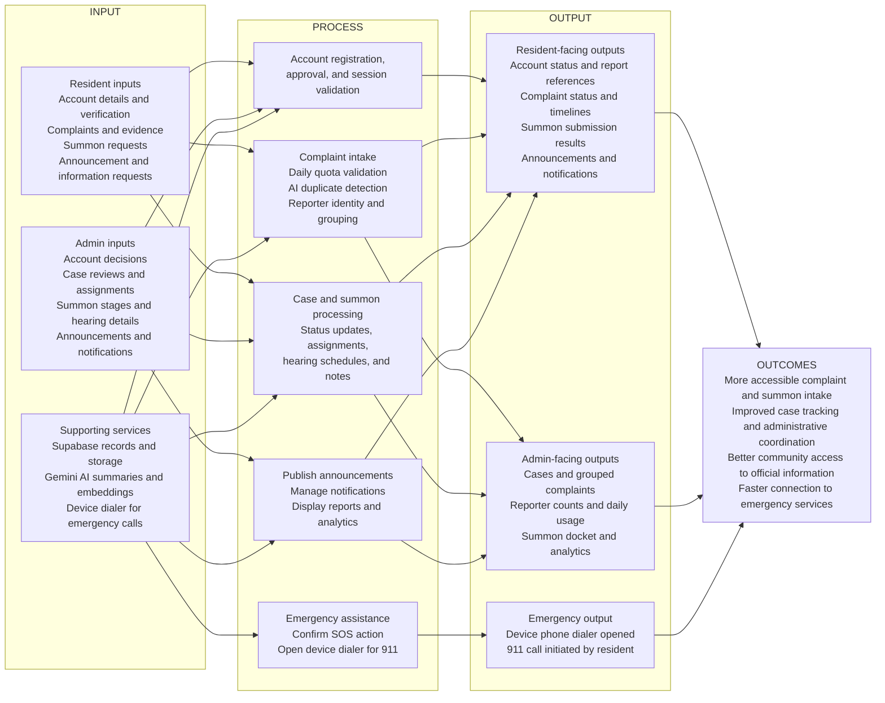

# Conceptual Framework

## Barangay Bangbang Civic Portal

The framework describes how residents' and barangay administrators' inputs are processed by the portal to produce coordinated public services and community outcomes. It uses an **Input–Process–Output–Outcome (IPOO)** model.

## Framework Components

| Component | Description | Examples in the portal |
|---|---|---|
| **Input** | Information and requests supplied by users and supporting services. | Registration details, verification documents, complaint descriptions, evidence photos, summon respondents, admin decisions, and Gemini matching results. |
| **Process** | Portal operations that validate, organize, and act on inputs. | Account approval and session checks; daily submission limits; AI-assisted duplicate detection; reporter grouping; case review; summon scheduling; announcement publishing; notification delivery. |
| **Output** | Results returned to residents and administrators. | Account status, report references, case timelines, duplicate-group results, summon schedules, bulletins, notifications, and analytics. |
| **Outcome** | Intended service improvements enabled by these outputs. | More accessible barangay services, better visibility into case progress, more coordinated case handling, informed residents, and a direct path to call emergency services. |

The framework is supported by **Supabase**, which provides database, storage, and backend functions, and **Gemini AI**, which supports complaint summarization and duplicate detection. The SOS feature is a device-level handoff to the 911 dialer; it does not currently send GPS location or an SOS alert to the portal backend.
