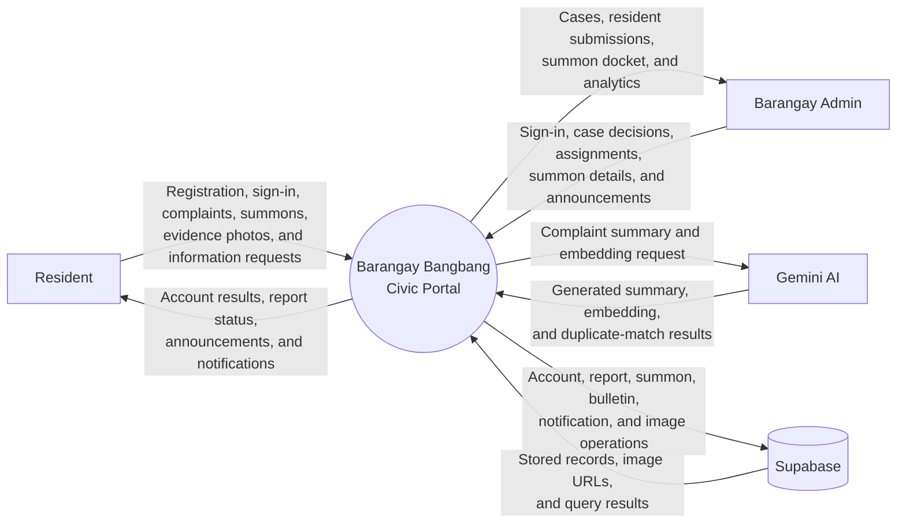

# System Context Diagram

The Barangay Bangbang Civic Portal is the system of interest. Residents and Barangay Admins interact with it directly. Gemini AI supports complaint summarization and duplicate detection, while Supabase provides persistent data storage, image storage, and backend services.
