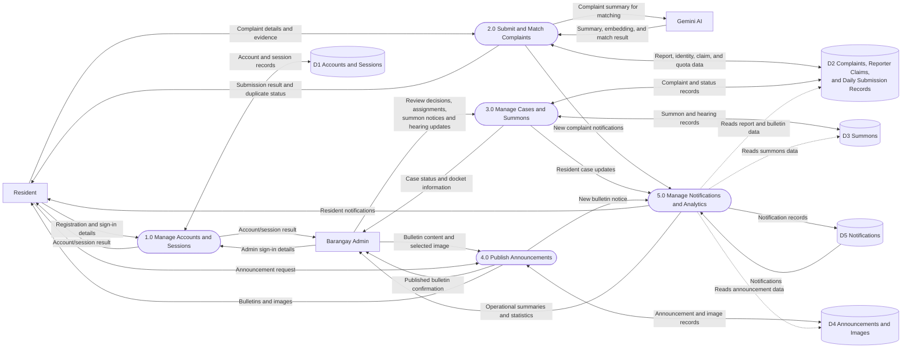

# Data Flow Diagram — Level 0

**External entities:** Resident, Barangay Admin, Gemini AI.  
**Processes:** Account/session management, complaint submission and matching, case/summon management, announcement publishing, and notifications/analytics.  
**Data stores:** Accounts and sessions; complaints, reporter claims, and daily submission records; summons; announcements and images; notifications.
