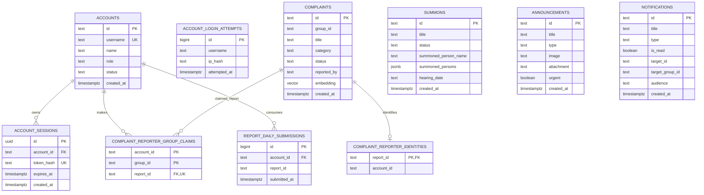

# Entity-Relationship Diagram

**Relationship notes:** Solid relationships above are enforced by foreign keys. `complaint_reporter_identities.account_id` is associated with `accounts.id` by application logic but has no database foreign key. `group_id` values group complaints and claims logically; they are not foreign keys. `report_daily_submissions.report_id` is unique per account but intentionally has no complaint foreign key. Notification targets and announcement image URLs are also references stored as text, not foreign keys. `account_login_attempts.username` is used for rate limiting and is not linked to `accounts`.

The diagram covers the application's public data tables. Supabase Storage holds announcement images separately; `announcements.image` stores the resulting public URL.
