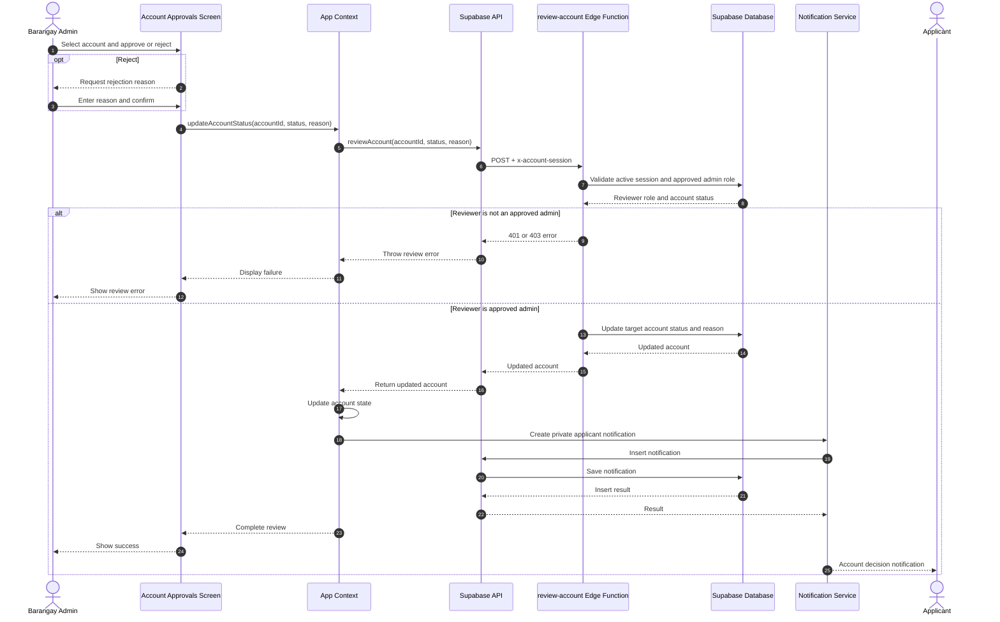
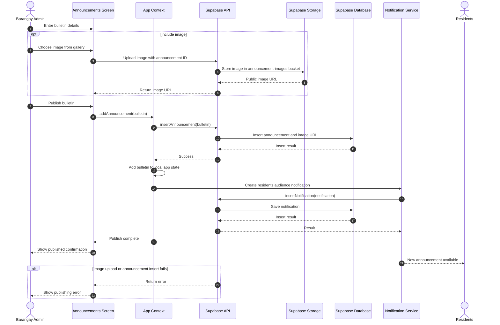

# Sequence Diagrams — Admin Workflows

These diagrams show key workflows performed by an approved Barangay Admin.

## 1. Review a Complaint or Complaint Group

```mermaid
sequenceDiagram
  autonumber
  actor Admin as Barangay Admin
  participant UI as Complaint Review Screen
  participant App as App Context
  participant API as Supabase API
  participant DB as Supabase Database
  participant Notify as Notification Service

  Admin->>UI: Open complaint and choose status
  UI->>App: updateGroupStatus(groupId, status, reason)
  App->>App: Update local complaint group and timelines
  App->>API: set_group_status(groupId, status, reason)
  API->>DB: Update all complaints with group_id
  DB-->>API: Updated successfully
  API-->>App: Success
  App->>API: Fetch complaints and summons
  API->>DB: Read current reports
  DB-->>API: Updated reports
  API-->>App: Refreshed reports
  App->>App: Find distinct reporter names in group

  loop For each reporter in group
    App->>Notify: Create personal status notification
    Notify->>API: Insert notification
    API->>DB: Save notification
    DB-->>API: Insert result
    API-->>Notify: Result
  end

  App-->>UI: Complete review action
  UI-->>Admin: Show updated status and timeline

  alt Update fails
    API-->>App: Database error
    App->>App: Log update failure
    Note over App,Admin: The current client keeps its optimistic local status; reload to reconcile with the database.
  end
```

## 2. Approve or Reject an Account



## 3. Publish an Announcement


