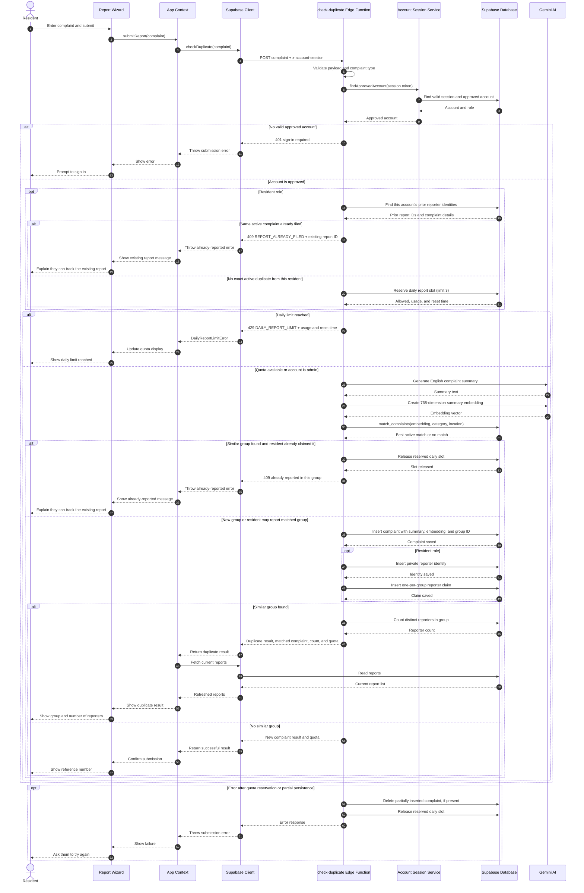

# Sequence Diagram — Complaint Submission

Complaint submission is a critical flow because it authenticates the resident, enforces the daily limit, checks for duplicate reports, stores private reporter identity, and may use Gemini AI before the complaint is saved.

**Notes:** Residents must have an approved account. Admin walk-ins use the same duplicate-matching and complaint insertion flow but are exempt from the resident daily quota and reporter identity/claim inserts. The quota reservation is released if a repeated group claim is detected or submission fails.
