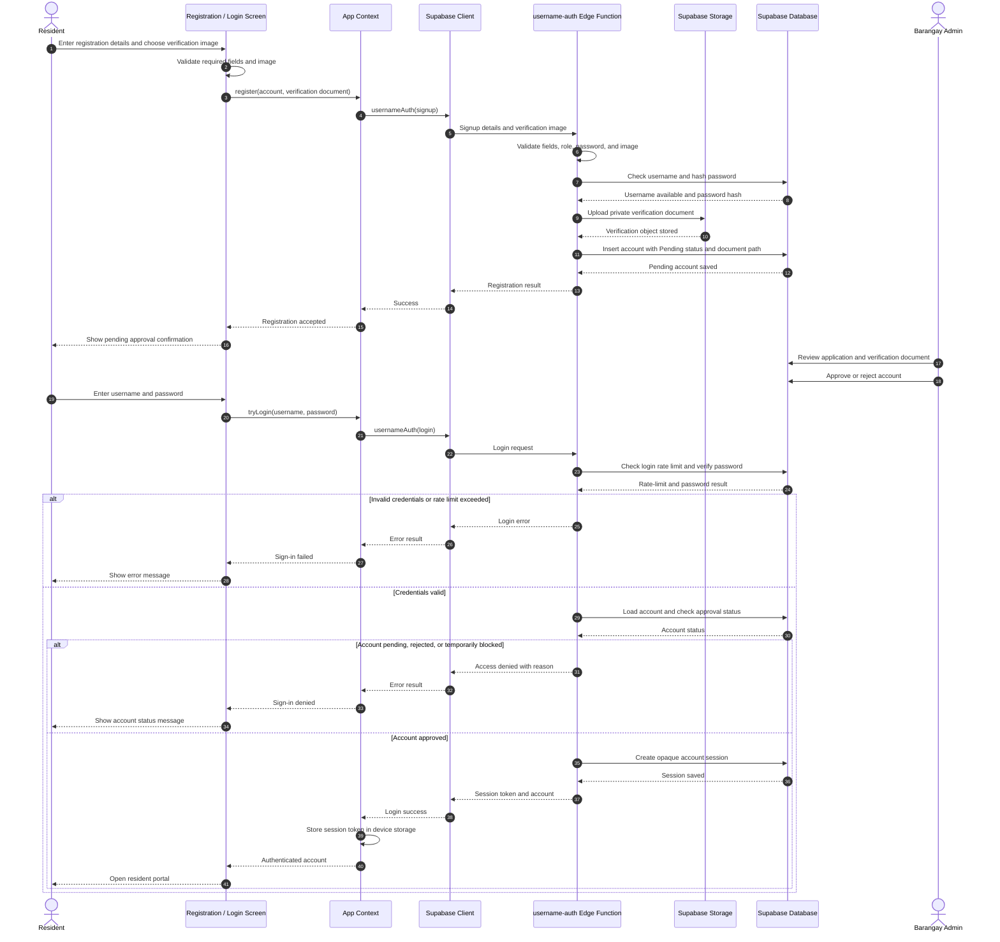
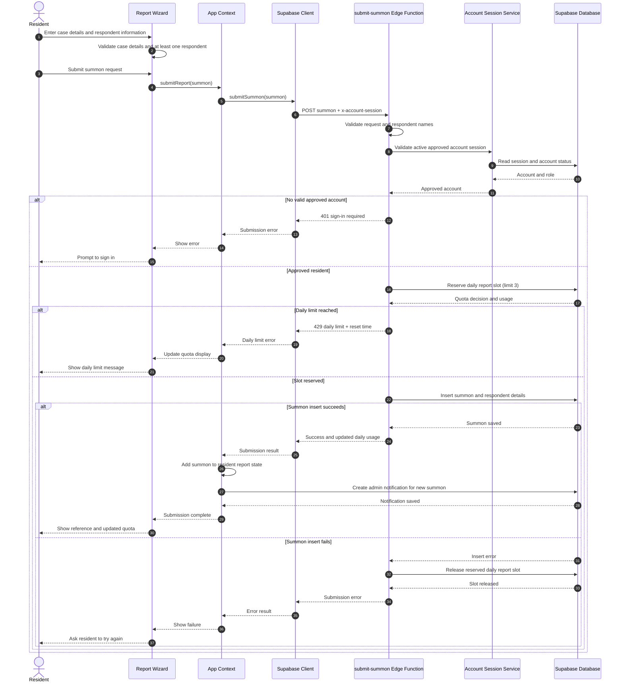
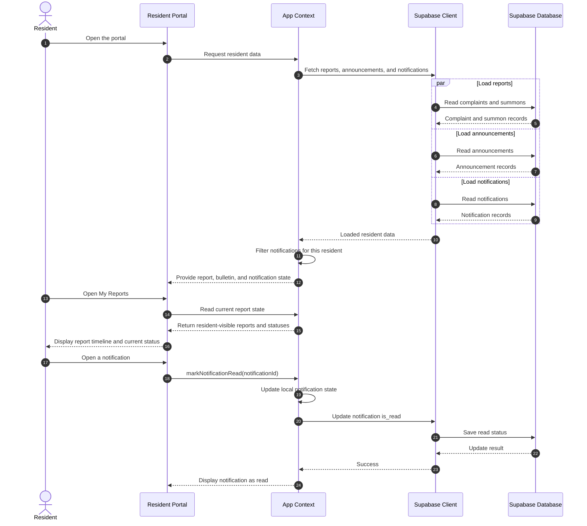

# Sequence Diagrams — Resident Workflows

The complaint workflow's full quota, Gemini duplicate-matching, and persistence sequence is documented in the [critical complaint-submission sequence diagram](./SEQUENCE-DIAGRAM-COMPLAINT-SUBMISSION.md). This document covers other resident-facing workflows.

## 1. Register and Sign In

## 2. Submit a Summon Request

## 3. View Reports and Notifications

