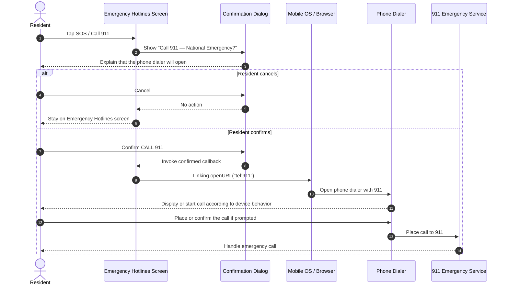

# Sequence Diagram — Trigger SOS

The SOS button currently opens a confirmation prompt and, when confirmed, asks the device to open its phone dialer for 911. It does not send an SOS event, location, or notification to the app backend.

**Important:** This flow depends on the device and platform supporting the `tel:` URL. The app does not verify that the call connected, and tapping SOS does not contact the barangay, share GPS location, or create a database record.
