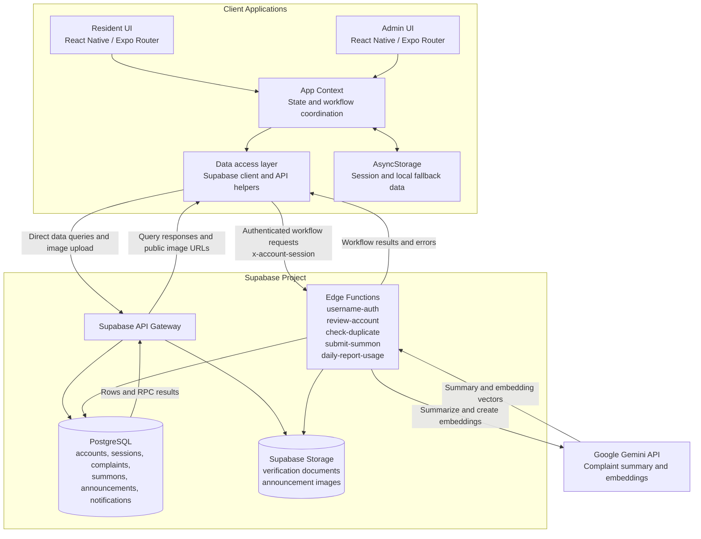

# System Architecture Diagram

## Component Responsibilities

- **React Native / Expo Router UI:** Resident and admin screens, forms, and navigation.
- **App Context:** Shared app state and orchestration of account, report, announcement, and notification operations.
- **Data access layer:** Calls Supabase tables and Storage directly where appropriate, and invokes Edge Functions for privileged workflows.
- **Supabase Edge Functions:** Validate sessions, enforce report limits, manage account review and summons, and coordinate complaint matching.
- **PostgreSQL:** Persistent relational data, reporter identities and claims, and database RPC functions.
- **Supabase Storage:** Private account verification documents and public announcement images.
- **Google Gemini API:** Generates complaint summaries and embeddings used in duplicate detection.
- **AsyncStorage:** Device-local session state and fallback data when Supabase is not configured.
