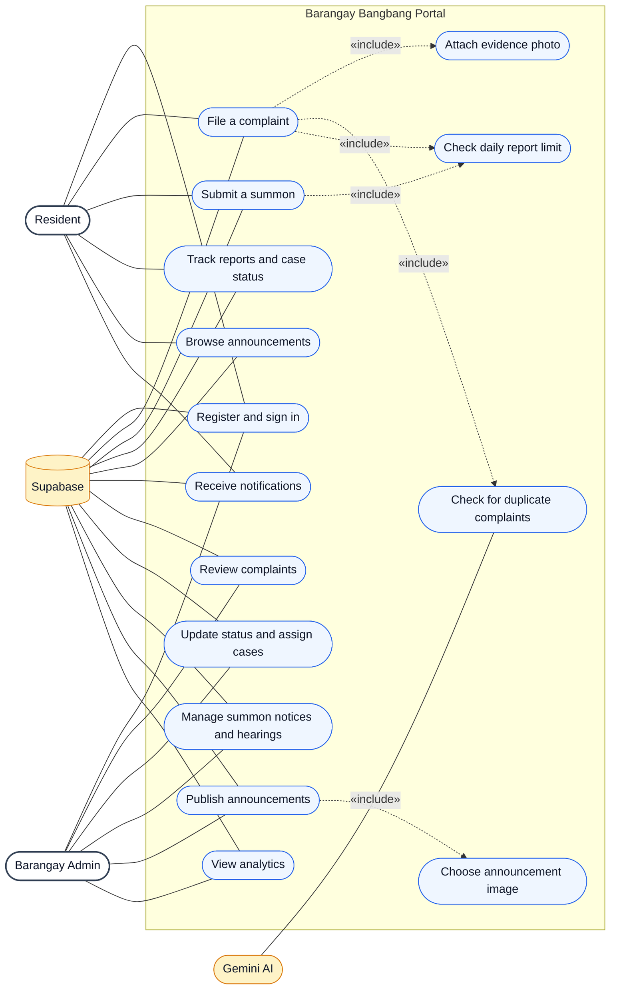

# Use Case Diagram

**Actors:** Residents use the portal to manage their accounts, submit and track reports, and read announcements. Barangay admins review cases, manage summons, publish announcements, and view analytics. Gemini AI supports duplicate complaint detection; Supabase stores portal data and uploaded images.
